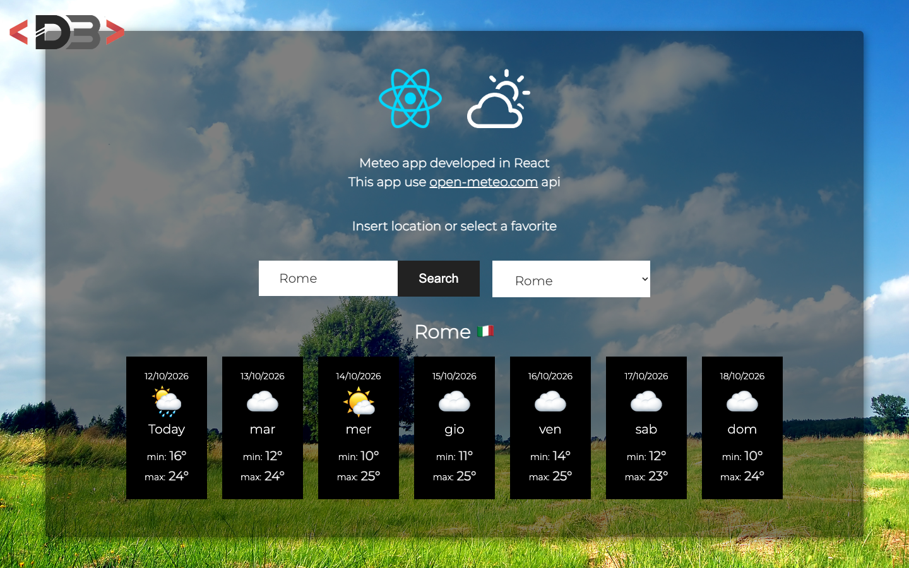

# React Meteo App

A weather forecast app built with React. Search for a location (or pick one from a list of favorites) and get the 7-day forecast, using the free [Open-Meteo](https://open-meteo.com/) API.

**Live demo:** <https://meteo-react.davidebalice.dev/>



## Features

- Search any location by name (Open-Meteo geocoding API)
- Favorite locations selectable from a drop-down list
- 7-day forecast with weather icon and min/max temperatures
- Location name with country flag
- Loading state and "location not found" error message
- No API key required

## Tech stack

- [React 18](https://react.dev/) (Create React App)
- [Open-Meteo API](https://open-meteo.com/) (geocoding and forecast)
- [Moment.js](https://momentjs.com/) for date formatting

## Getting started

### Requirements

- Node.js 18 or later
- npm

### Installation

```bash
git clone https://github.com/davidebalice/meteo-app-react.git
cd meteo-app-react
npm install
```

### Available scripts

| Command         | Description                             |
| --------------- | --------------------------------------- |
| `npm start`     | Start the development server            |
| `npm run build` | Create a production build in `build/`   |
| `npm test`      | Run the tests                           |

## Project structure

```
src/
├── components/   # Header, Meteo (data fetching), Input, Select, Result, Day
├── data/         # Favorite locations
└── App.js
```

## Author

**Davide Balice** – [davidebalice.dev](https://www.davidebalice.dev)
